<p align="center">
  
</p>

<h1 align="center">Herbert</h1>
<p align="center">A little robot. A big idea. Find the shortest program through a world of patterns.</p>
<p align="center">
  <a href="https://github.com/hugogu/herbert/actions/workflows/ci.yml"></a>
  <a href="LICENSE"></a>
  
  
</p>
<p align="center"><b>English</b> · <a href="README.zh-CN.md">简体中文</a> · <a href="CONTRIBUTING.md">Contribute</a> · <a href="CHANGELOG.md">Changelog</a></p>

Herbert is an offline programming puzzle game for **iPhone, iPad, and Mac**, built with
SwiftUI. Guide the robot to every target using H, a tiny language whose short programs
can express surprisingly intricate paths. Learn three commands, discover recursion,
and keep making your solution smaller.

Start with **10 introductory lessons**, then explore **40 advanced and synthesis challenges** in
wall-assisted counting, parameter swaps, recursive returns, mutual recursion and
composition. All **50 original puzzles** have English, Chinese and Japanese goals
and two optional hints. Reference programs are verified by the native engine;
H language behavior is also audited against the HOJ reference implementation.
The default open-source edition also includes **1,769 community problems**, preserving
their IDs, authors and byte limits. The **App Store edition contains only the 50 originals**.
The course uses continuous **L01–L50** numbers: ten introductory lessons followed
by forty advanced and synthesis challenges. Only the first two fit a direct sequence of commands.
L04–L06 introduce reusable patterns; L11–L22 explore open geometric compositions.
Broken wall landmarks and trap motifs guide the route while leaving alternative traversals.
Display numbers are separate from internal save IDs; retired records remain importable.
L41–L50 add paired inverse paths, changing dimensions and layered recursive composition,
while preserving the previous forty lessons.

## Download for Mac

**[Download the 1.1.0 DMG](https://github.com/hugogu/herbert/releases/download/v1.1.0/Herbert-macOS-universal.dmg)**
— macOS 14+, Apple Silicon and Intel. Open the DMG and drag Herbert to Applications;
no Xcode is needed. Includes all 1,819 problems.

Screenshots below are captures of the 1.0.0 app, except the 3D board, which was captured during
1.1.0 development.

This DMG is ad-hoc signed and **not Apple notarized**. macOS may block its first
launch; follow [Apple's instructions](https://support.apple.com/en-us/102445) for
**System Settings → Privacy & Security → Open Anyway** if you trust the download.
See [checksums, installation and build details](docs/macos-distribution.md).

[Explore the original curriculum](docs/original-course.md) · [Open geometry design](docs/open-course-design.zh-CN.md) · [Community study](docs/advanced-course-design.md) · [App Store build and device testing](docs/app-store.md) · [App Store listing kit](store/README.md)

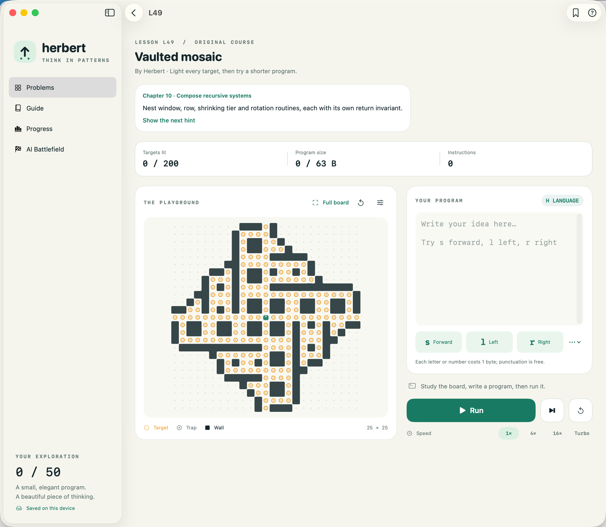

*Actual native macOS App Store edition with English UI. L29 “Vaulted mosaic” combines
shrinking tiers, window patterns and fourfold rotation. Its nested procedures must
return to their starting position and heading before the next pattern can fit.
The app follows English, Simplified Chinese, or Japanese language preferences; other
languages fall back to English.*

Short landscape layouts keep the sidebar compact and put the board and code side by
side, with statistics below. Puzzle details, AI trial notes and rules open from title tags.
See the [compact workspace capture](docs/screenshots/en/compact-playground.png) from a short Mac window.

To ask an AI in its own chat window, open **Puzzle details** (or **AI trial**) and choose
**Copy AI prompt**. It includes Battlefield's exact English rules, worked examples and
the selected board, ready to paste as one message.

## Small programs, intricate places

The six-chapter [original course](docs/original-course.md) grows from a single `s` to
layered recursive systems. Partial walls and trap ribbons reveal folds and rotational
units while keeping multiple approaches open. These are three challenges; click a board for its
full game screen:

| L18 · Folding shells | L24 · Snowmelt seal | L30 · Astral cathedral |
| --- | --- | --- |
| [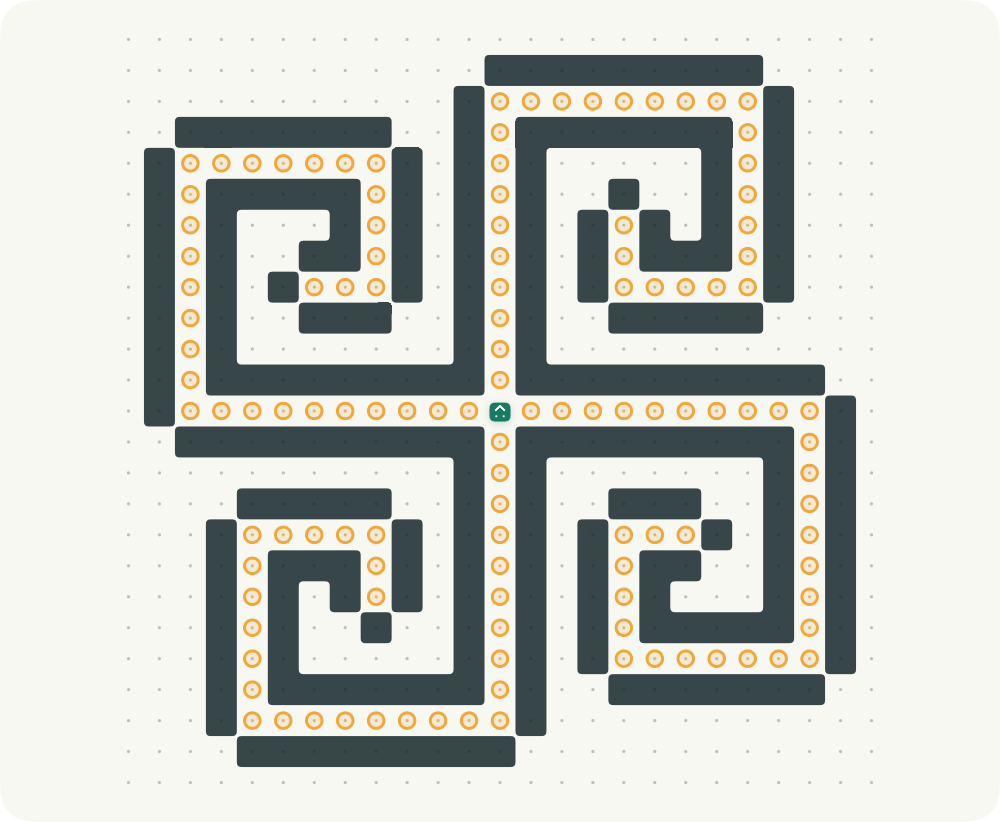](docs/screenshots/en/course/course-rosette.png) | [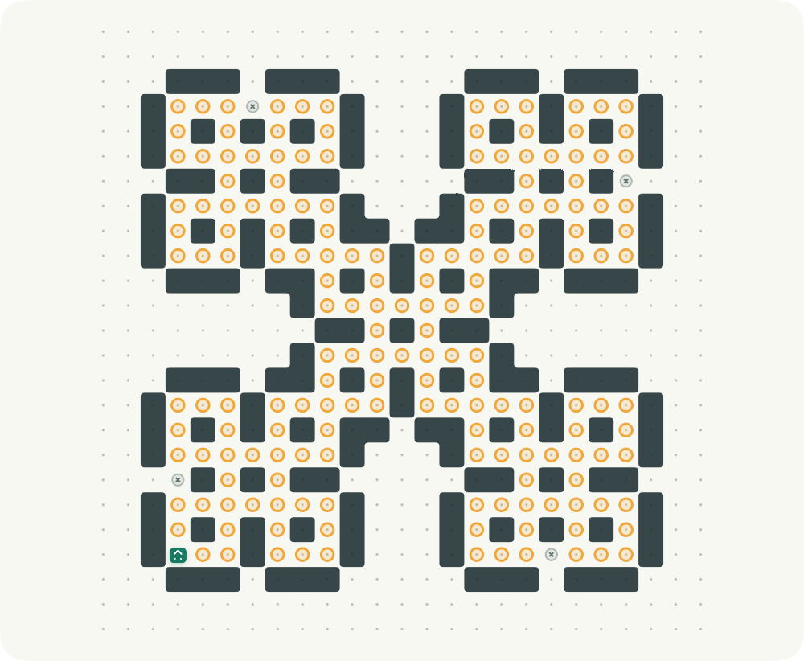](docs/screenshots/en/course/course-seal.png) | [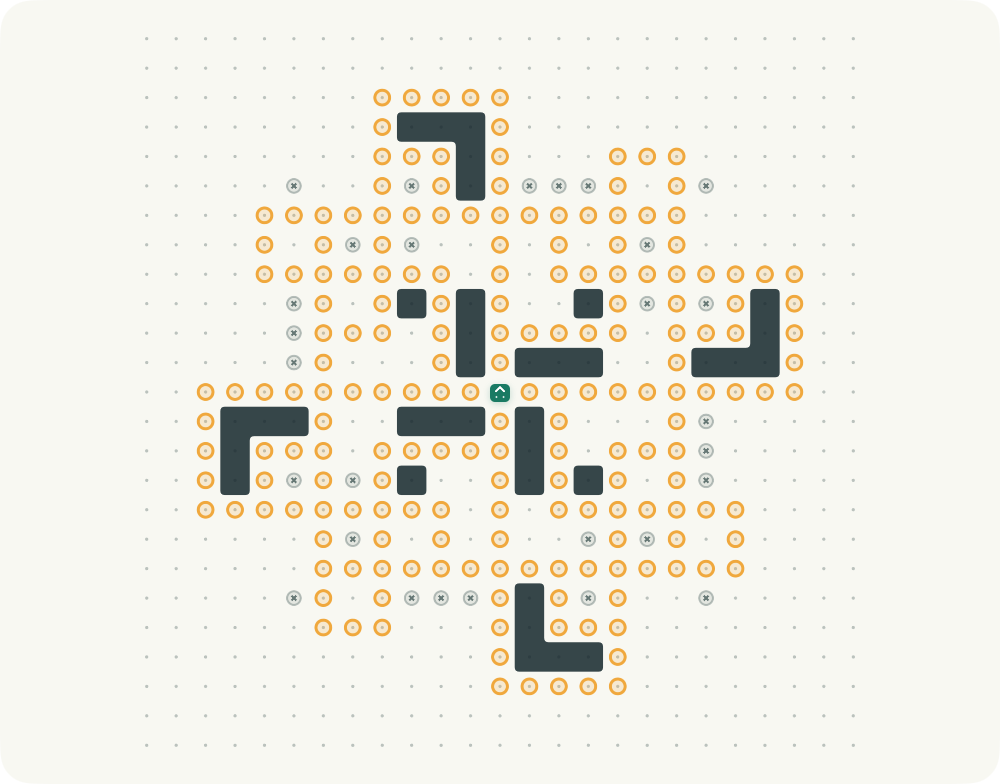](docs/screenshots/en/course/course-cathedral.png) |
| Recursive return · ≤ 33 bytes | Selective instruction expansion · ≤ 34 bytes | Chiral branching + composition · ≤ 56 bytes |

*These original puzzles and their screenshots are MIT licensed. Budgets are verified
achievable, not proven minima. Our [community study and design notes](docs/advanced-course-design.md)
explain the progression and the simple-loop shortcuts removed during design.
The redesigned course is included in the 1.1.0 release.*

| L07 · Turning rose | L08 · Tandem lanterns |
| --- | --- |
| [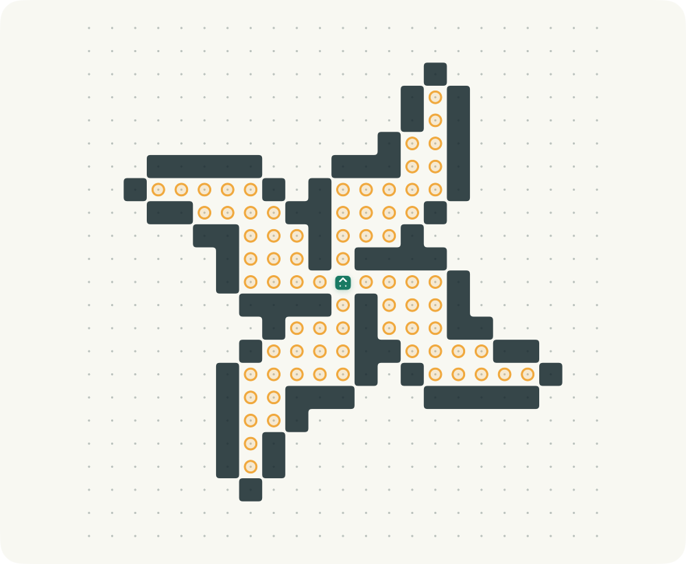](docs/screenshots/en/course/course-rose.png) | [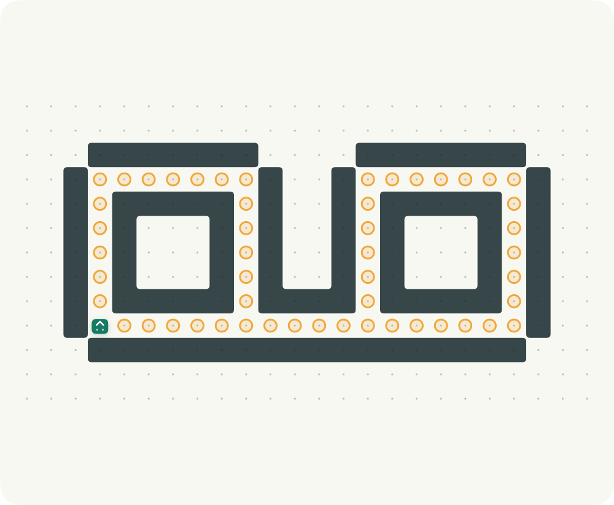](docs/screenshots/en/course/course-lanterns.png) |

## Optional verified leaderboard

The **HerbertAppStore** build can use Sign in with Apple and a Cloudflare Workers +
D1 leaderboard from **My → Progress**, with overall and per-puzzle score rankings.
Original puzzle pages offer **Upload this answer** after a run, opening Apple
sign-in when needed. Account also supports **Upload & Share my Solutions** for saved answers
and public nickname editing. Uploads are opt-in; the server replays each H program
against versioned boards and computes its score.
Sessions stay in Keychain. Local play and backups still work without an account.
The service is disabled until its deployment URL and Apple credentials are configured.
[Deployment, security and independent admin API](docs/cloud-leaderboards.md).

A separate **HerbertLearning** scheme provides original exercises, the editor and
local progress without cloud accounts, rankings or AI competition. It is a product
option for evaluating local learning distribution, **not a confirmed licensing
exemption**. [Mainland China assessment](docs/china-distribution.md).

## AI Battlefield

**Updated in 0.3.8:** Anthropic Messages providers, manual puzzle retries, fuller
answer recovery, provider-aware retry waits, and consistent timing/token figures in
progress, history and share cards.

One **Match Settings** panel replaces match modes. Time and
per-problem token limits are optional and off by default; each problem allows three
attempts by default. Every model receives the same per-problem budget. Reaching an
output or token limit marks that problem **Burnout**, retains received reasoning and
cancels its remaining retries. Other problems and entrants continue.

- Add multiple OpenRouter, SiliconFlow, Google Gemini, OpenAI or Anthropic compatible providers. Discover models
  through `/models`, choose default entrants, and save settings locally. API keys stay
  in the system Keychain.
- **Model Settings** covers sampling and advanced parameters. Automatic thinking is on
  by default, using the highest advertised reasoning effort for supported models.
  Explicit advanced JSON overrides these defaults. Output allowances come from the
  shared match policy and provider capabilities, without a separate model cap.
- Choose models and puzzles; a new match starts from the previous match's choices and
  settings. Models work in parallel with identical Markdown rules and board prompts.
  With limits off, all entrants can finish their selected attempts.
- Mac setup places entrants and puzzles side by side. Progress uses compact two-line
  answers and score-sorted model columns. Saved results open as a full page in the
  History tab and expand with the main window. A persistent Back action returns to
  the history list; answer dialogs remain resizable. Dates sit beside the match title,
  elapsed time and tokens align under the actions, and scoring/answer tips open from
  the progress help button. iPhone uses short icon tabs.
- **Anthropic compatible** supports Claude and custom Messages API endpoints with
  native authentication, model discovery, streamed thinking, signed-block retries and
  cache-aware usage. Select it in AI Providers and enter the base URL ending in `/v1`.
- Model headers show normalized percentages with total points as a reference,
  input/output/total tokens and average output speed. Each attempt has its own elapsed timer;
  live timers advance and finished durations remain fixed in history.
- Rate limits (429) appear as **Overloaded**. Transient retries honor provider wait
  hints and use exponential backoff with jitter; the countdown can be cancelled with Stop.
  Provider prefixes and `(free)` are omitted from display names. Select an answer to
  inspect submissions, native feedback and retries, then **Try on board** with code
  prefilled. **Back to match** returns to the results, preserving personal progress.
- Full response retains final text, independently collapsible Markdown reasoning and
  credential-redacted errors. Live attempts show **Thinking**, **Generating answer**
  or **Waiting for provider**. Provider and network failures are distinct from rejected
  H programs; retained reasoning is explicitly marked when generation has ended.
- Shared prompt `herbert-h-v4` includes coordinate rulers, target coordinates and two
  native-verified worked boards, including a recursive pinwheel separate from scored L30.
- Stop cancels active calls. Matches save locally and can be shared as PNG cards.
  Model headers and share cards show the same input/output and reported total tokens,
  average output speed, cumulative attempt time and points.
  Token accounting notes sit below puzzle progress.

AI is optional and uses **your own API credits**. Streaming usage can be estimated or
partial; token budgets cannot guarantee a provider's final bill. iPhone/iPad matches end
when the app enters the background. [Setup and accounting](docs/ai-battlefield.md) · [Privacy](PRIVACY.md).

Non-accepted progress cells offer a **manual retry** arrow: one extra attempt with the saved
prompt, model settings and remaining budgets, including from history. Attempts and original
output stay visible. Explicit final answers placed in reasoning can be recovered for judging
or board trials. Over-limit programs can run in Playground for analysis without earning an
accepted solution; OpenRouter 402 credit failures become Burnout.

## Herbert Benchmark

Use the **50 original puzzles** as an AI programming benchmark: movement and
walls, numeric and instruction parameters, recursion, multiple procedures and their
composition. Every answer runs in the same bounded native H engine used for human play.
The platform measures actual board outcomes and code length, with no model acting as judge.

**Score per attempt = target coverage × (80 + 20 × code savings)**, where coverage is
final lit targets / total targets, and code savings is `1 − H bytes / puzzle byte limit`.
Round to two decimals, keep the best attempt per puzzle, and sum the scores.
Display the benchmark as **total points / (100 × selected puzzles) × 100%**:
160 points over eight puzzles is **20%**. Unsolved puzzles remain in the denominator;
this measures coverage and code efficiency, rather than the fraction of solved puzzles. Compile-invalid
and over-limit programs earn zero; incomplete runs can earn partial points. Traps reset
coverage. A shorter accepted program earns more points. Robot steps do not affect score.
Rank by **score descending → total tokens ascending → completion time**.
Cached input and all retries count toward token consumption. Older 0.3.0 histories retain
their original 100-per-solved-puzzle scoring and tie-breaks.

For repeatable comparisons, use the same puzzle set, attempts, Match Settings and shared
prompt, and record sampling/reasoning parameters. The optional **per-model, per-problem
token budget** covers input and output across retries. With both limits off, every entrant
can finish without a match deadline or app-imposed output cap. Known provider output
limits still apply; unknown Chat Completions limits use provider defaults. Anthropic Messages requires a
request cap, using discovered capacity or a documented 65,536-token fallback.
History snapshots preserve the full shared prompt and its version, boards, parameters, received answers and the scoring policy;
provider model versions can still change. This composite score is our benchmark policy,
inspired by the original site's shortest-code ranking. [Scoring and limits](docs/ai-battlefield.md#judge-and-rank) · [Benchmark design and architecture analysis](docs/ai-battlefield-benchmark.md).

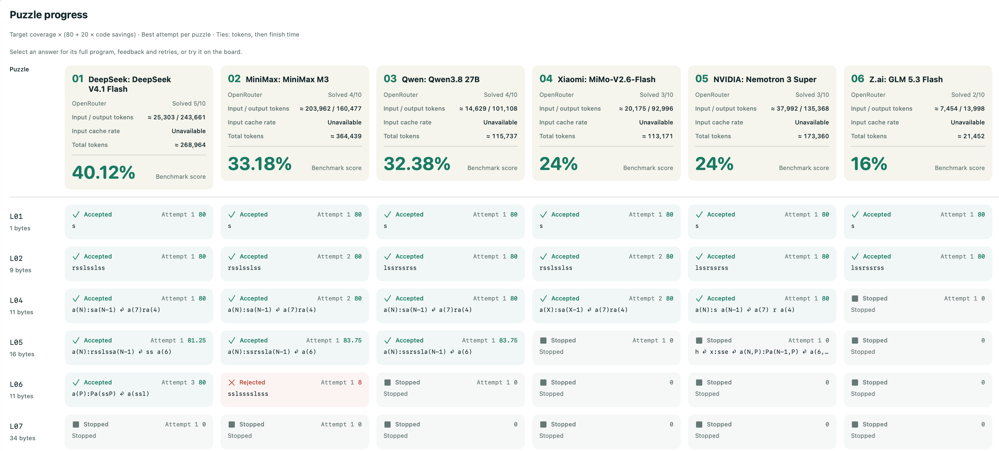

*User-provided English app capture showing four model columns from a twelve-puzzle
community selection. Several answers were stopped; this illustrates an actual run,
rather than a completed controlled comparison.*

[Current progress UI](docs/screenshots/en/battlefield/ai-battlefield.png) ·
[New match](docs/screenshots/en/battlefield/ai-new-match.png) ·
[Match Settings](docs/screenshots/en/battlefield/ai-match-settings.png) ·
[Model Settings](docs/screenshots/en/battlefield/ai-model-settings.png) ·
[Puzzle selection](docs/screenshots/en/battlefield/ai-puzzles.png) ·
[Readable rules](docs/screenshots/en/battlefield/ai-rules.png) ·
[Providers](docs/screenshots/en/battlefield/ai-providers.png) ·
[Anthropic setup](docs/screenshots/en/battlefield/ai-anthropic-provider.png) ·
[Models](docs/screenshots/en/battlefield/ai-models.png) ·
[Full-page three-AI history](docs/screenshots/en/battlefield/ai-history.png) ·
[Native feedback](docs/screenshots/en/battlefield/ai-answer.png) ·
[Burnout and retained reasoning](docs/screenshots/en/battlefield/ai-burnout.png) ·
[Provider error details](docs/screenshots/en/battlefield/ai-provider-error.png) ·
[Live thinking](docs/screenshots/en/battlefield/ai-thinking.png) ·
[Interrupted provider stream](docs/screenshots/en/battlefield/ai-stream-error.png) ·
[Network diagnostics](docs/screenshots/en/battlefield/ai-network-error.png) ·
[Board trial](docs/screenshots/en/battlefield/ai-trial.png) ·
[PNG share preview](docs/screenshots/en/battlefield/ai-share.png)

*Linked UI captures use deterministic test entrants and demonstrate the current app.
Their scores are illustrative, not commercial model results.*

## Community patterns

The default open-source edition also includes the archived community collection.
These examples are excluded from the App Store edition. Search their IDs in `Herbert`:

The problem panel shows the **original best reference** separately from the byte limit
and your personal shortest solution. These are archived `Best` lengths from the
[original problem list](http://herbert.tealang.info/problems.php), not live records
or proven minima; unavailable entries show **No record**. For example, #0027 allows
39 bytes and has an archived best of 14 bytes.
[See the problem panel](docs/screenshots/en/community-reference.png).

Tap the board legend to learn the symbols in Modern, Classic or 3D style:
**walls block movement**, while **traps can be entered but turn off all lit targets**.
Both continue the program; traps leave the robot on the trap.
[See the board guide](docs/screenshots/en/community-board-guide.png).

<table>
  <tr>
    <td align="center" width="33%"><a href="docs/screenshots/en/flower.png">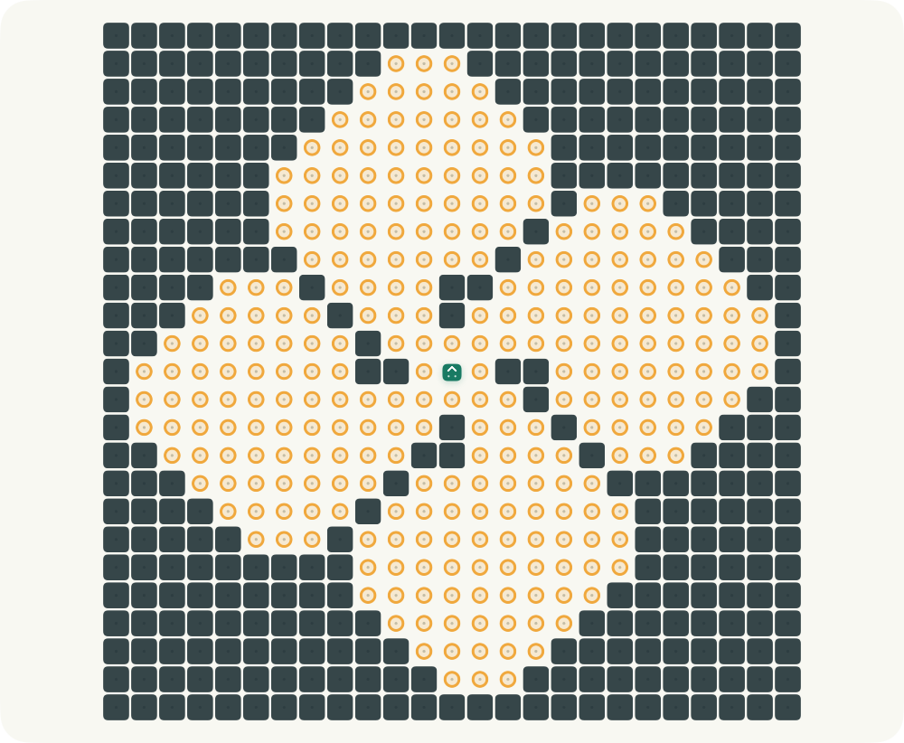</a></td>
    <td align="center" width="33%"><a href="docs/screenshots/en/shuriken.png">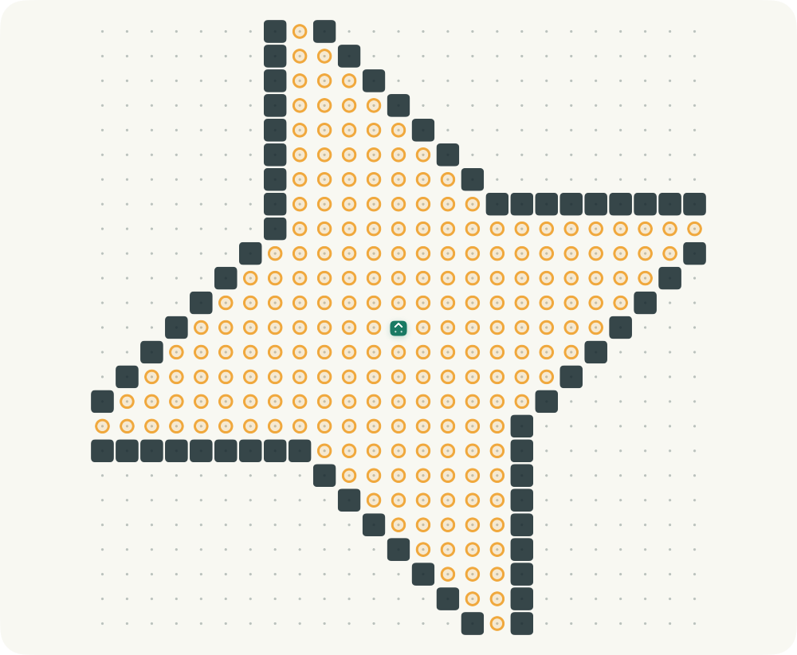</a></td>
    <td align="center" width="33%"><a href="docs/screenshots/en/butterfly.png">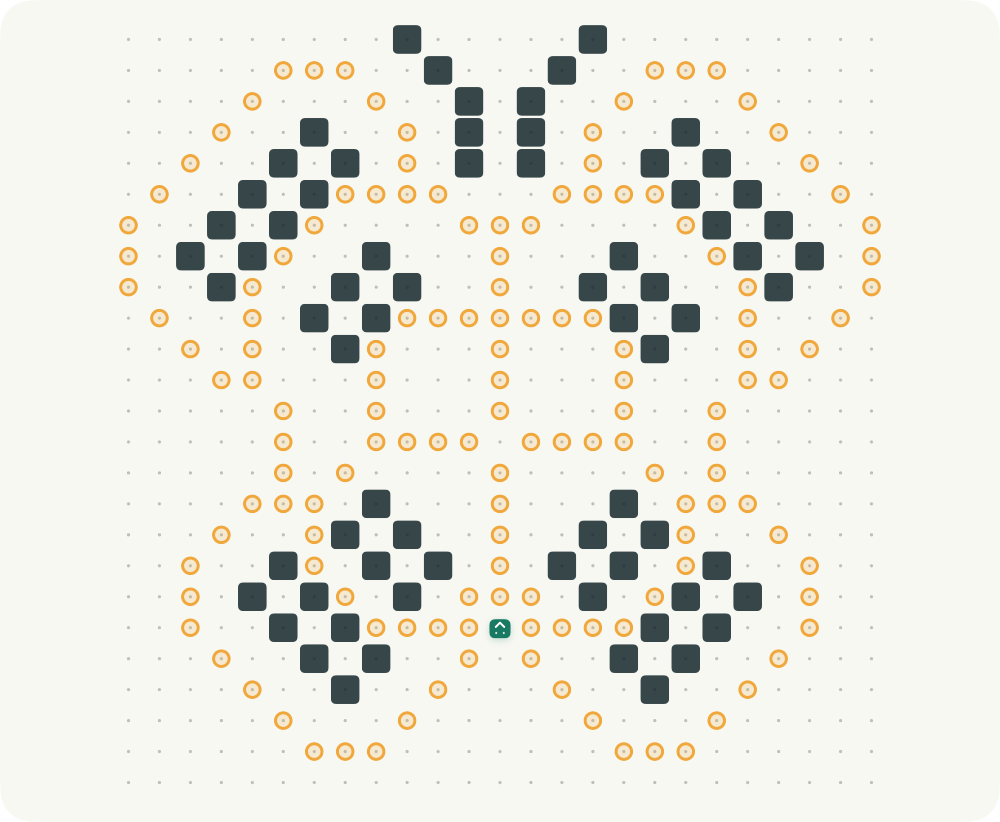</a></td>
  </tr>
  <tr>
    <td align="center"><b>#0037 · Flower</b><br>nai · ≤ 20 bytes</td>
    <td align="center"><b>#0027 · Shuriken</b><br>snuke · ≤ 39 bytes</td>
    <td align="center"><b>#0361 · Butterfly</b><br>nadsuki · ≤ 27 bytes</td>
  </tr>
</table>

*These are board screenshots from the running app. Click a board to see its full game screen.*

## Modern, Classic or 3D

<table>
  <tr>
    <td align="center"><a href="docs/screenshots/en/course/course-mosaic.png">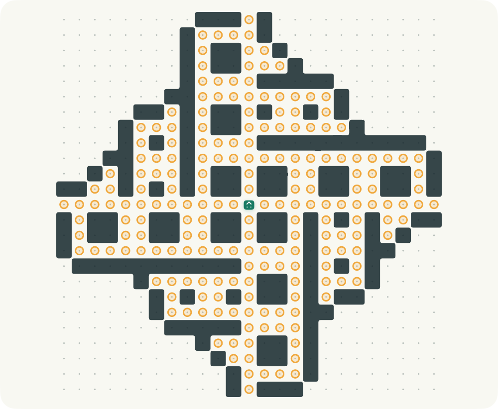</a></td>
    <td align="center"><a href="docs/screenshots/en/course/course-mosaic-classic.png">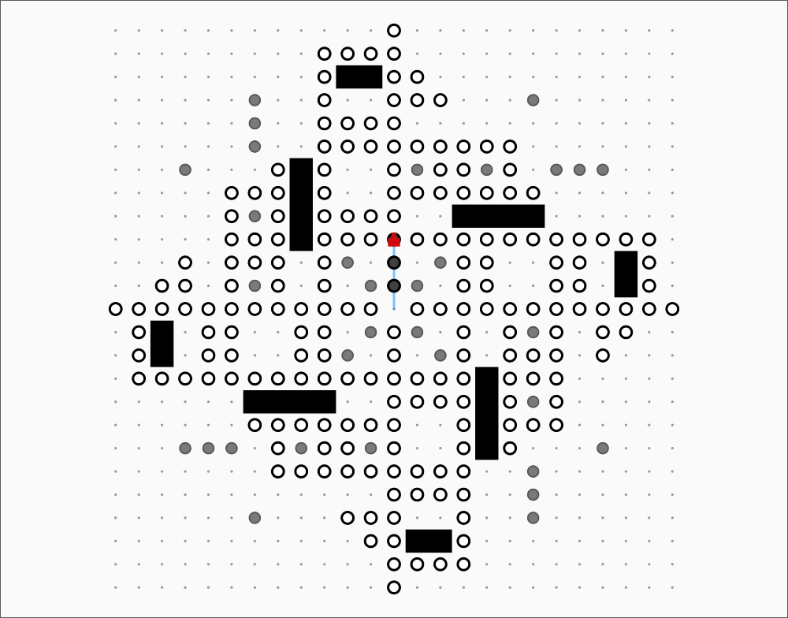</a></td>
    <td align="center"><a href="docs/screenshots/en/three-d-stage.png">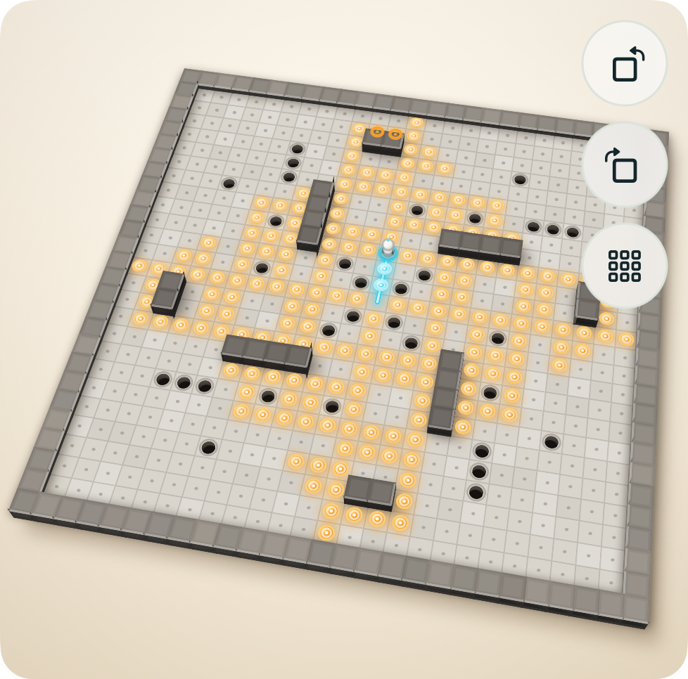</a></td>
  </tr>
  <tr><td align="center">Modern · default</td><td align="center">Classic · movement trail</td><td align="center">3D · lit diorama</td></tr>
</table>

*All three are actual app captures of original lesson L29. Classic follows the original
rules-page board appearance, and its screenshot follows three successful moves. Adjacent
walls share a continuous outline in Modern and Classic. The 3D capture was taken on the
iOS Simulator after the same three moves. Use the sliders button above the board to change
style, grid dots, and trail visibility.*

**3D style** draws the same board as a lit diorama: charcoal stone walls with soft shadows,
glowing amber discs for targets (cyan once lit), dark holes for traps, a glowing trail and a
white robot whose face turns with him. It is only a different view of the same game, so
scores, saves and AI Battlefield are unaffected.

- **Look around.** Drag to turn the board, pinch to zoom toward your fingers, twist to
  rotate and double-tap to reset; the buttons turn it by quarter turns and change the tilt.
  On Mac, Shift-drag pans. Vertical swipes over the board still scroll the page on iPhone
  and iPad.
- **See what a wall hides.** A target or Herbert behind a wall keeps a see-through ring, so
  nothing is lost at a low angle.
- **Get a bigger board.** A 25 × 25 board is foreshortened in 3D, so the panel is taller and
  the view opens nearly straight on when it is tall or square, which gives about a fifth
  larger cells. **Enlarge board** opens a stage that gives the whole window to the board, with
  turn, tilt, zoom, follow-Herbert, focus and reset buttons, your progress, a read-only
  program preview and the run controls. Wide windows put the controls beside the board.

<table>
  <tr>
    <td align="center"><a href="docs/screenshots/en/three-d-stage.png">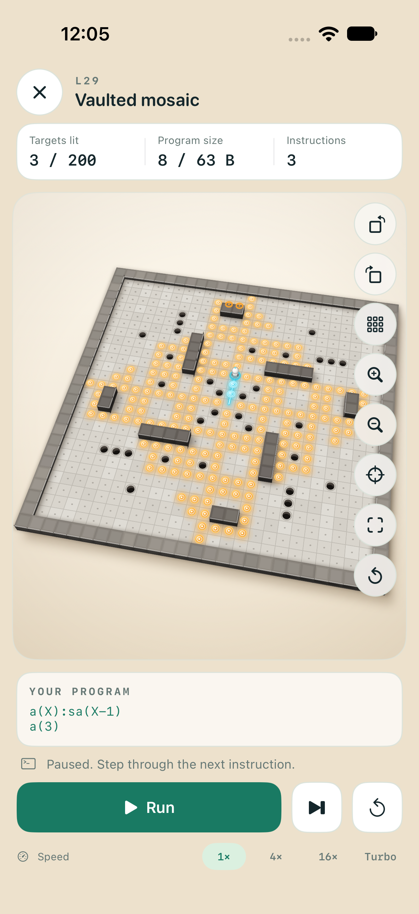</a></td>
  </tr>
  <tr><td align="center">Enlarge board · iPhone</td></tr>
</table>

*Captured on the iOS Simulator (iPhone 18 Pro), not on a physical device.*

<details>
<summary>Explore the original course library</summary>

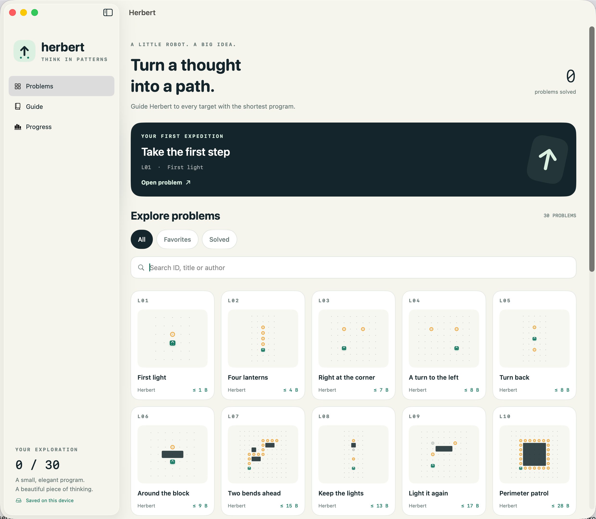

</details>

## What you can do

- **Learn one idea at a time.** Follow the 50-lesson course from one step to the Palace of woven paths;
  reveal hints individually when you need them. Titles, goals and hints support all three languages.
- **Play anywhere offline.** The default edition bundles 1,819 problems; the App Store
  edition bundles 50 originals. Search by ID, title, or author;
  bookmark favorites and return to your last problem.
- **Think in H.** Use `s`, `l`, and `r`, then build single-letter procedures, numeric and
  command parameters, and recursive programs. Original byte-counting rules are preserved.
  See the [HOJ compatibility audit](docs/hoj-compatibility.md) for tested behavior and limits.
- **Watch your idea unfold.** Run, pause, reset, or single-step. Change speed, zoom the board,
  and switch between the full 25 × 25 grid and its occupied region. See the robot’s complete
  movement trail, including at Turbo speed.
- **Make the board yours.** Open the sliders button above the board to choose Modern
  (default), Classic or 3D, show/hide grid dots for counting cells, and toggle the movement
  trail. Preferences stay on this device. Resetting or editing code clears the trail;
  hiding it keeps recording.
- **Play in your language.** English, Simplified Chinese, and Japanese cover navigation,
  the guide, accessibility, and interpreter errors. Community puzzle titles/authors are preserved.
- **Use a layout that fits.** Stacked board and editor on phones; side-by-side play on iPad
  and Mac. Native text editing, cursor-aware command buttons, and `⌘ Return` on Mac.
- **Keep your progress.** Drafts, favorites, and shortest solutions save locally. Export JSON
  backups and merge them back after their solutions have been replayed and validated.
- **Keep your privacy.** No app accounts, analytics SDKs or ads. Human play stays offline;
  optional AI requests go directly to the providers you configure. [Data details](PRIVACY.md).

## Try your first program

Open lesson **L01 · First light** and enter:

```text
s
```

Each `s` moves forward one square; `l` turns left and `r` turns right. Light every amber
ring within the problem's byte limit. Walls block movement. Traps erase lit targets.

The challenge is program size, not the number of steps. Each letter and each numeric
literal counts as one byte: `12` is one byte, and punctuation and whitespace are free.
The in-app guide introduces procedures and recursion; [rule notes](docs/rules.md) explain
the full language and compatibility limits. Programs execute in the custom H interpreter,
with bounded execution; they do not execute Swift or shell commands.

## Build and run

You need **macOS and Xcode 16+ with Swift 6**. The checked-in Xcode project uses a local
Swift package and has **no third-party package dependencies**. Xcode 27.0 is the locally
verified toolchain; CI uses the default Xcode on the macOS 26 runner.

```sh
git clone git@github.com:hugogu/herbert.git
cd herbert
open Herbert.xcodeproj
```

Choose the **Herbert** scheme and your Mac, iPhone, or iPad destination, then Run.
For a physical iOS device, select your own Development Team in Signing & Capabilities.
No developer account is configured in the repository.

| Scheme | Included content | Intended use |
| --- | --- | --- |
| `Herbert` (default) | 50 original lessons + 1,769 archived community puzzles | Open-source edition |
| `HerbertAppStore` (**Herbot Bot**) | 50 original lessons; optional verified leaderboard | TestFlight / App Store candidate |
| `HerbertLearning` | 50 original lessons; fully local; no AI/cloud/Game Center | Offline learning candidate; classification must be confirmed |

The community archive is a separate optional Swift package target, not a runtime-hidden
file in the store app. CI audits built iOS and Mac store apps for content isolation.
Personal signing settings can go in ignored `Config/Local.xcconfig` as `DEVELOPMENT_TEAM = YOUR_TEAM_ID`.
See [device and archive instructions](docs/app-store.md) before uploading.

```sh
# Formatting, importer unit tests, and core unit/integration tests
scripts/check.sh

# Build the native Mac app
xcodebuild -project Herbert.xcodeproj -scheme Herbert \
  -destination 'platform=macOS' CODE_SIGN_IDENTITY=- build

# Compile for iPhone and iPad without signing
xcodebuild -project Herbert.xcodeproj -scheme Herbert \
  -destination 'generic/platform=iOS' CODE_SIGNING_ALLOWED=NO build

# Run native Mac UI tests (uses a separate test save file)
xcodebuild -project Herbert.xcodeproj -scheme Herbert \
  -destination 'platform=macOS' CODE_SIGN_IDENTITY=- test
```

**Status: 1.1.0.** Core tests and the Mac and iOS builds pass, and UI tests have run in the
iPhone and iPad simulators. The full native Mac UI suite and real-device testing have not been
rerun for 1.1.0. Herbot Bot 1.0.0 has been submitted to App Review; a notarized Mac build is
still to come. See [verification details](docs/verification.md).

## How it is built

| Location | Responsibility |
| --- | --- |
| `Herbert/` | SwiftUI screens, native editors, animation, app state |
| `Sources/HerbertCore/` | UI-independent H parser, VM, board, session, progress storage |
| `Sources/HerbertCloud/`, `worker/` | HTTPS client, Apple identity verification, D1 and server judge |
| `Sources/HerbertCommunity/` | Optional community archive, excluded from App Store targets |
| `Sources/HerbertBattlefield/` | Provider protocol, streaming client, parallel competition engine, judging and local history |
| `Tests/HerbertCoreTests/` | Language unit tests and game/save/backup integration tests |
| `Tests/HerbertBattlefieldTests/` | AI engine, budgets, cancellation, persistence and HTTP/SSE integration tests |
| `HerbertUITests/` | Native UI tests and reproducible screenshot captures |
| `scripts/` | Project/icon generation, validated catalog import, local checks |
| `docs/` | Rules, provenance, architecture, screenshots, verification |

`HerbertCore` can be built and tested independently with `swift test`.
After adding or removing app Swift files, run `python3 scripts/generate_project.py`.
Generated project files are checked in; contributors do not need XcodeGen.

Progress goes through `ProgressRepository` into an atomic, versioned JSON file in the
system-provided Application Support directory. Cloud sync is planned, not implemented:
**App → authenticated Cloudflare Worker → D1**. Database credentials will stay out of
clients. Read the [architecture notes](docs/architecture.md) for merge and migration rules.

## Contributing

Bug reports, documentation improvements, localization, accessibility work, and device
testing are welcome. See [CONTRIBUTING.md](CONTRIBUTING.md) for setup, checks, and places
to start. For feature ideas, open an issue before a large implementation.

- [Report a bug](https://github.com/hugogu/herbert/issues/new?template=bug_report.yml)
- [Suggest an improvement](https://github.com/hugogu/herbert/issues/new?template=feature_request.yml)
- [Browse good first issues](https://github.com/hugogu/herbert/labels/good%20first%20issue)
- [Code of conduct](CODE_OF_CONDUCT.md) · [Security policy](SECURITY.md)

### Next steps

- Test and refine phone keyboard, rotation, touch, and accessibility behavior on devices.
- Refine English/Japanese translations while preserving original puzzle titles and author credits.
- Expand H compatibility fixtures and make execution easier to inspect.
- Finish device testing and App Store privacy/metadata preparation using the original-only scheme.
- Add optional authenticated cloud sync while keeping offline play first.

## Credits and license

The Herbert programming challenge was originally created by **Wild Noodle Corporation**;
Wild Noodle's [published account](https://wildnoodle.medium.com/how-to-create-an-effective-hiring-assessment-strategy-for-your-organization-c797266eaf34)
credits its founder, Brian Conte, with developing the `h` language. Herbert was also used
in Microsoft's Imagine Cup algorithm competition. This repository is an independent
implementation based on public rules, not an official Wild Noodle or Microsoft release.

The open-source edition separately includes a snapshot of community puzzles from
[Herbert Online Judge](http://herbert.tealang.info/), created by **quolc** and its community.
That site's [published rules](http://herbert.tealang.info/rule.php) and
[problem collection](http://herbert.tealang.info/problems.php) are linked for attribution;
each original problem author retains their rights. The original Flash client, online
accounts, submissions, and leaderboard are not included; original best scores are an
import-time snapshot, not live rankings.

Our source code, 50 original lessons, original icon, and documentation use the **[MIT License](LICENSE)**.
Third-party community puzzle data and community layouts visible in screenshots are
**not relicensed under MIT**. See [NOTICE.md](NOTICE.md) for the precise scope and provenance.
